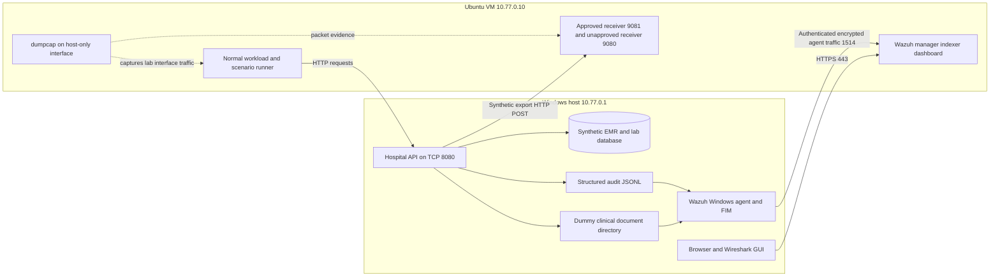

# Healthcare SOC Design

**Date:** 22 October 2026. **Status:** proposed design for the requested implementation plan; implementation has not started.

## Purpose and assignment interpretation

Build a small, reproducible hospital security lab in which normal clinical workflows and three controlled attack scenarios produce real network traffic, application audit events, and file-system changes. Wazuh detects relevant behavior; Wireshark supplies packet evidence; a dashboard and report explain what happened and what the evidence can establish.

The authoritative source is [Project.docx](../../../Project.docx). It specifies three students, three attacks, Wireshark and Wazuh or Splunk, and a 30/30/40 marking split for simulation, attacks, and detection. The Healthcare SOC option explicitly includes hospital IT, electronic medical records, laboratory systems, medical-device monitoring logs, unauthorized access, suspicious record access, ransomware-like file activity, and unusual transfers. The general task paragraphs contain smart-meter wording. This design adapts those paragraphs to the selected healthcare domain while retaining all deliverables. Confirm that interpretation when registering the topic; do not build unrelated utility infrastructure.

**Research question:** Can correlated application, endpoint, and packet evidence distinguish the three chosen healthcare security scenarios from representative normal hospital activity?

Success means a working simulation and traceable evidence, not a claimed production hospital deployment or an accuracy figure based only on scripted positive examples.

## Approaches considered and recommendation

| Approach | Benefit | Tradeoff | Decision |
|---|---|---|---|
| Wazuh, one Linux VM, Windows hospital simulator | Alerts, endpoint collection, file-integrity monitoring, dashboards; no Splunk trial expiry dependency | Linux VM setup and rule testing | Recommended after the user delegated platform selection |
| Splunk Enterprise plus application/file telemetry | Strong search workflow and dashboard flexibility | Must verify an available license that supports alerts; Splunk Free disables alerting | Alternative if suitable institutional access is confirmed |
| Multiple hospital VMs, full EHR, directory server, separate network sensor | More realistic infrastructure boundaries | Higher memory and integration cost, without being required by the brief | Optional expansion only after core acceptance |

Splunk Free's restrictions are documented in [About Splunk Free](https://help.splunk.com/en/splunk-enterprise/administer/admin-manual/10.6/configure-splunk-licenses/about-splunk-free). Wazuh's [quickstart](https://documentation.wazuh.com/current/quickstart.html) recommends 4 vCPU, 8 GiB RAM, and 50 GB storage for 1–25 agents. These are vendor recommendations, not a performance test on the target host.

## Resources and assumptions

Before setup, record actual memory, storage, virtualization, privileges, and required tool availability on the selected host. Vendor minimums and a successful preflight are not evidence that the complete workload will run reliably.

Allocate one Ubuntu Server 24.04 LTS VM: 4 vCPU, 8 GiB RAM, 60 GB virtual disk. Keep the Windows workload small. Use VirtualBox with a host-only network as the default; an already working Hyper-V equivalent is acceptable if the same addressing and isolation tests pass. The implementation must verify virtualization, privileges, actual free memory, and stable operation first. If the host cannot sustain the VM, move the Wazuh VM to a group member's machine on a dedicated lab network; do not quietly reduce monitoring coverage.

Repeat the capacity check with the complete workload before measured evaluation: archive indexing, FIM, capture, receivers, device traffic, dashboard searches, and representative bursts. The initial setup smoke test is not evidence that the complete stack fits reliably.

Planning assumption: four weeks, three students, roughly 25–35 hours per student including integration and documentation. This is an estimate, not a supplied deadline. No new paid service is assumed; license and download conditions must be checked at installation time.

Use the Wazuh 4.14 documentation family reviewed for this plan. Record and pin the exact mutually compatible manager, indexer, dashboard, and agent packages selected during setup. Use Python 3.12 and Flask 3.1 API conventions; freeze installed patch versions and transitive dependencies after the smoke test. Flask interfaces were checked against [version 3.1.1 documentation](https://github.com/pallets/flask/tree/3.1.1/docs); that is an API reference, not a claim that 3.1.1 is the latest or preferred security patch.

## Architecture

The hospital API contains separate modules for authentication, records, laboratory workflows, device telemetry, documents, and exports. These are logical systems with distinct identities, event types, and workflows on one service, not independently deployed clinical products. Wazuh's security services and the scenario runner share the VM to fit the host. That is a lab compromise, not a production management-plane architecture.

The subnet is proposed. Check for local/VPN overlap before assigning it, and update all configurations together if it changes. Bind services only to the host-only addresses. Disable the VM's installation-time NAT adapter for measured runs; do not use bridged networking. Scope Windows firewall access to the VM address. Keep indexer and management API ports private. Use temporary lab credentials only.

Capture on the VM's actual host-only interface, identified using `dumpcap -D` and a smoke request. Every hospital request and export crosses that interface. Do not assume traffic is visible on a physical Wi-Fi interface. Analyze copied PCAPNG files in Windows Wireshark.

HTTP is deliberately used for synthetic hospital traffic to make request/response inspection possible. Wazuh's UI remains HTTPS; agent transport remains encrypted/authenticated. An optional HTTPS comparison can demonstrate visibility limits. Without TLS session secrets, packet inspection does not reveal application payloads. This prototype uses a representative JSON/HTTP protocol, not implemented HL7 FHIR, HL7 v2, DICOM, or a certified medical-device protocol. Explain those real healthcare protocols as future integration points without claiming support.

## Hospital model and runtime boundaries

Seed 200 synthetic patient records in three wards, six human accounts with clinical/laboratory/records/admin roles, one laboratory service identity, and ten medical-device identities. Include a care-assignment table, device-to-ward mapping, lab orders/results, 50 dummy documents, and synthetic export attachments. Names, identifiers, and clinical values are fictional.

Normal workflows include clinician sign-in and assigned-record reads, nurse observations, laboratory order/result exchange, device heartbeats, occasional document updates, and an approved export. Preserve actual API responses and database state; generating arbitrary JSON logs alone does not meet simulation acceptance.

Keep source in the project workspace. Keep live SQLite, logs, monitored files, and receiver output outside OneDrive synchronization. On Windows use `$env:USERPROFILE\HealthcareSOCLab\hospital`; its `documents` child is the only mutation target for the file scenario. VM and installers use sibling directories under `HealthcareSOCLab`. Linux runtime data lives under `/home/labuser/healthcare-soc-runtime`. The application runs as an ordinary user; Wazuh installation and configuration use only the privileges they require.

The application enforces authentication and coarse roles in every mode. In `observe` mode, an authenticated clinician can read outside their care assignment and an authorized records clerk can export to either of the two registered lab receivers. Those deliberately permissive policies allow investigation of misuse; they are explicit simulation choices. In `enforce` mode, care-assignment and business-destination checks deny those actions and log the denial. Arbitrary URLs, arbitrary paths, and arbitrary commands are never accepted.

## Three scenarios

| ID | Scenario | Controlled behavior | Independent evidence |
|---|---|---|---|
| S1 | Account misuse and suspicious EMR access | Six failed logins over 30 seconds, then a successful login with a known synthetic clinician credential, followed by 30 reads of distinct off-assignment records within 60 seconds | Actual 401/200 responses, audit records, packet streams, Wazuh failed-login and record-access alerts |
| S2 | Ransomware-like document modification | Update 50 pre-created dummy documents, once each, over 50 seconds via the document API | Before/after hashes, native Wazuh FIM changes, application writes, HTTP requests, restored hashes |
| S3 | Unusual export to an unapproved destination | An authorized lab clerk exports a 5,000,000-byte synthetic bundle to the registered but business-unapproved receiver | Application completion event, receiver byte count and SHA-256, TCP/HTTP evidence, Wazuh destination/volume alert |

S1 combines unauthorized access indicators and suspicious record reads to cover four healthcare signal categories with exactly three scenarios. The known credential represents account compromise; no credential theft or password cracking is claimed. S2 overwrites dummy content with harmless marker data; it does not execute malware or cryptographic ransomware. The attack condition is the unusually fast write activity, not a magic string containing an attack name. S3's unapproved receiver is inside the isolated lab; it represents an exfiltration destination without sending data outside the lab.

Use 30 minutes of benign activity for calibration, separate benign holdout sessions, and three measured repetitions of each scenario. Fix rule settings before holdout evaluation. The ground-truth manifest is stored outside monitored paths and is never a rule input. Run IDs and request IDs may support evidence linkage; they must not determine whether an alert fires.

During S2, pause benign document edits from the pre-run baseline/hash check through the FIM drain and post-run hashing. Other normal hospital workflows continue. This deliberate exception prevents unrelated edits from obscuring which hashes and native FIM events belong to the 50 controlled modifications.

Separate measured runs only after reconciling source events with Wazuh ingestion, followed by a 65-second quiet interval after the final processed event. Delayed delivery must not contaminate the next run's frequency window.

## Detection and evidence design

Windows agent collection reads the application JSONL and monitors the pre-existing dummy-document directory in real time. Use native file-integrity evidence to corroborate S2. Do not infer file modification solely from what the scenario runner says it attempted. Wazuh supports local JSON log collection and local-directory FIM; see [log monitoring](https://documentation.wazuh.com/current/user-manual/capabilities/log-data-collection/monitoring-log-files.html) and [FIM settings](https://documentation.wazuh.com/current/user-manual/capabilities/file-integrity/basic-settings.html).

Enable JSON archiving and Filebeat archive forwarding so normal events can be searched in `wazuh-archives-*`; alerts use `wazuh-alerts-*`. Restrict and size retention for the lab. Enabling archive files alone is insufficient to make them searchable. Follow [Wazuh event logging](https://documentation.wazuh.com/current/user-manual/manager/event-logging.html).

Implement small, explicit rules: failed-login frequency; off-assignment record access; record-read frequency; document-write frequency; unapproved destination; and large unapproved transfer. Use configured policy facts and measured server-side bytes, not scenario labels. Compare expected alerts with actual alert exports and raw evidence. Native FIM alerts are corroboration and have their own identifiers; do not claim every file alert is a ransomware incident.

Dashboard panels must show both benign workload and actionable alerts, including record access, authentication, document activity, export volumes, and collection health. Missing telemetry must be displayed as unknown or stale, not as zero threats. Detection success, evidence completeness, latency, and false-positive counts are separate measures.

## Scope and acceptance

Core scope includes three scenarios, real HTTP interactions, endpoint FIM, search queries, dashboard, evidence bundles, reproducible setup/reset, role assignment, a final report, and a live demonstration. Exclude full EHR deployment, real patient data, real malware, Internet targets, machine learning, automatic clinical-system isolation, and compliance certification.

Acceptance requires all four simulated domains operating; clean baseline searchable; all three scenarios detected in three measured repetitions; S2 independently corroborated by FIM and hashes; S3 sender/receiver agreement; a held-out benign evaluation; fresh packet evidence; a documented mitigation rerun; and a rebuild/reset performed by another group member. Targets are design acceptance criteria, not measured outcomes.

Healthcare context informs prioritization: confidentiality of records, integrity of laboratory/documents, and availability of clinical workflows. Mitigation discussion can use the voluntary [HHS healthcare cybersecurity performance goals](https://hhscyber.hhs.gov/cybersecurity-performance-goals.html), especially access control, backups, segmentation, and incident preparation. This does not establish legal compliance in any jurisdiction.

The implementation sequence, interfaces, thresholds, searches, and evidence checklist are in [the implementation plan](../plans/2026-10-22-healthcare-soc.md). Student names, the actual deadline, and hypervisor availability remain administrative/setup inputs; they do not prevent completing this plan.
